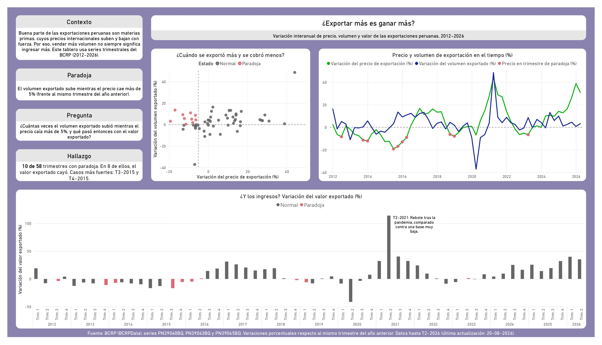
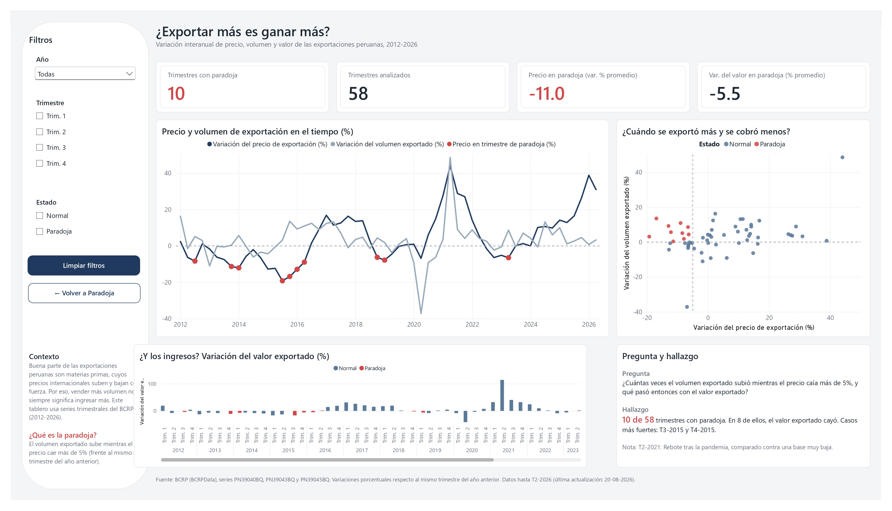

# Dashboard BCRP: rediseño de Power BI con agentes de IA

Rediseño de un dashboard de Power BI usando **Claude Code** junto al **Power BI Modeling MCP** y el plugin oficial **`powerbi-authoring`** de Microsoft, trabajando sobre el formato **PBIP** (PBIR + TMDL) con control de versiones en Git.

El objetivo del proyecto es probar un flujo de trabajo real de **desarrollo de BI asistido por IA**: el agente se encarga del diseño y la edición de archivos, y el analista define la historia, pone los límites, supervisa cada cambio y valida los resultados.

---

## Antes y después

| Diseño original (manual) | Rediseño con agente de IA |
|---|---|
|  |  |

- **Diseño original:** ~1 jornada laboral (prototipado en Figma, probando combinaciones de colores).
- **Rediseño con agente:** 10 minutos generando y ejecutando el promt, más 10 minutos de validación.

**Lo que agregó el rediseño:** fila de KPIs, panel lateral de filtros (Año, Trimestre, Estado), botón "Limpiar filtros", navegación entre páginas, paleta consistente (Normal / Paradoja) en todos los visuales y una jerarquía visual más clara.

---

## La pregunta de negocio

> **¿Exportar más es ganar más?**

Buena parte de las exportaciones peruanas son materias primas, cuyos precios internacionales suben y bajan con fuerza. Este tablero analiza una **"paradoja"**: los trimestres en que el **volumen exportado sube mientras el precio cae más de 5%** (variación frente al mismo trimestre del año anterior).

**Hallazgo:** 10 de 58 trimestres presentan la paradoja, y en 8 de ellos el valor exportado cayó. Los casos más fuertes fueron T3-2015 y T4-2015.

---

## Flujo de trabajo

El proyecto siguió cuatro etapas:

1. **Planificar:** se definieron el contexto, la audiencia, las preguntas que debía responder la página y las restricciones (no modificar el modelo semántico ni la página original).
2. **Diseñar:** el agente analizó la página existente y propuso un plan (layout, visuales, paleta, filtros y botones) en *plan mode*. No editó nada hasta que el plan fue aprobado.
3. **Crear:** el agente generó una página nueva ("Paradoja - Rediseño") editando directamente los archivos PBIR.
4. **Validar:** revisión visual en Power BI Desktop, revisión del diff en Git y verificación independiente de los KPIs con SQL.

### Qué hizo el agente y qué hice yo

| Agente (Claude Code) | Analista |
|---|---|
| Analizar la estructura PBIR de la página original | Definir la pregunta de negocio, la narrativa y el hallazgo |
| Proponer el plan de diseño | Escribir el prompt con contexto, restricciones y criterios |
| Generar layout, visuales, filtros, botones y formato | Revisar y aprobar el plan y cada permiso sensible |
| Ajustes al modelo (p. ej. agregación de `Año` → No resumir) | Revisar cada cambio en el diff de Git antes del commit |
| | Validar los KPIs contra la fuente de datos |

---

## Validación

El diff confirmó que **todos los cambios del rediseño quedaron dentro de `dashboard-bcrp.Report/definition/pages/`**, sin tocar el modelo semántico, tal como se pidió.

Los KPIs se verificaron directamente contra la base de datos DuckDB:

```sql
SELECT
    COUNT(*) AS trimestres_analizados,
    COUNT(*) FILTER (WHERE volumen_x_var > 0 AND precio_x_var < -5) AS trimestres_paradoja,
    ROUND(AVG(precio_x_var) FILTER (WHERE volumen_x_var > 0 AND precio_x_var < -5), 1) AS precio_en_paradoja,
    ROUND(AVG(valor_x_var)  FILTER (WHERE volumen_x_var > 0 AND precio_x_var < -5), 1) AS valor_en_paradoja
FROM comercio_exterior;
```

| KPI | Dashboard | SQL |
|---|---|---|
| Trimestres analizados | 58 | 58 ✅ |
| Trimestres con paradoja | 10 | 10 ✅ |
| Precio en paradoja (var. % promedio) | -11.0 | -11.0 ✅ |
| Var. del valor en paradoja (% promedio) | -5.5 | -5.5 ✅ |

También se probaron los segmentadores y los botones (limpiar filtros y navegación).

---

## Stack

- **Power BI Desktop**: formato **PBIP** con reporte en **PBIR** (JSON) y modelo en **TMDL**.
- **Claude Code**: agente de IA en la terminal, usado en modo manual (aprobación de cada acción).
- **Power BI Modeling MCP** (Microsoft): conexión del agente al modelo semántico abierto en Power BI Desktop.
- **Plugin `powerbi-authoring`** (Microsoft, *Skills for Fabric*): skills de autoría de reportes y modelos.
- **Git / GitHub Desktop**: un commit antes de cada cambio del agente, como punto de restauración y registro del proceso.
- **DuckDB**: almacenamiento de los datos y validación con SQL.

---

## Estructura del repositorio

```
dashboard-bcrp.pbip                 # Abrir con Power BI Desktop
dashboard-bcrp.Report/
  definition/pages/                 # Una carpeta por página y por visual (PBIR)
dashboard-bcrp.SemanticModel/
  definition/tables/                # Tablas, columnas y medidas (TMDL)
dashboard-bcrp-1_inicial.jpg        # Captura del diseño original
dashboard-bcrp-2_agente_ia_claude.jpg  # Captura del rediseño
```

---

## Origen de los datos

Los datos vienen de mi pipeline ETL **[etl-bcrp-airflow](https://github.com/AndreRHz/etl-bcrp-airflow)**, que extrae series trimestrales de la API del **BCRP** (BCRPData: PN39040BQ, PN39043BQ y PN39045BQ), las transforma y las carga en DuckDB, orquestado con Apache Airflow en Docker.

> **Nota:** el repositorio no incluye los datos (`cache.abf` está excluido). Para actualizar el reporte se necesita la base DuckDB generada por el ETL, conectada por ODBC con el DSN `DuckDB`.

---

## Aprendizajes

- **Las restricciones explícitas importan.** Decirle al agente qué *no* debe tocar fue tan importante como decirle qué hacer, y el diff permitió comprobar que lo respetó.
- **Planificar antes de ejecutar** sale más barato que corregir una implementación equivocada.
- **El criterio sigue siendo humano.** El agente acelera el diseño, pero la pregunta de negocio, la interpretación y la validación de los números son responsabilidad del analista.
- **PBIP + Git** convierten un reporte de Power BI en algo revisable línea por línea, igual que el código.

---

**Autor:** Christian Andre Rodriguez Angeles · Analista de Datos
[LinkedIn](https://www.linkedin.com/in/christian03rodriguez/) · [GitHub](https://github.com/AndreRHz)
